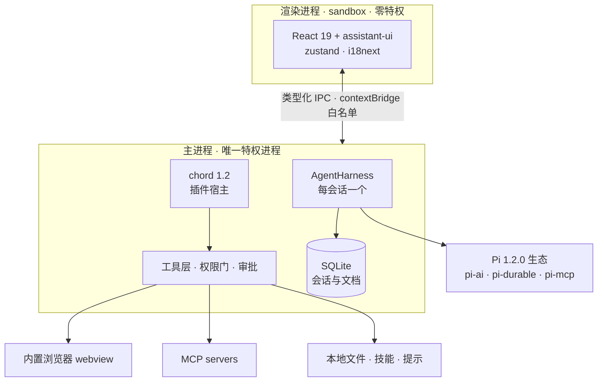

<div align="center">


# Oint

**本地优先的桌面 Agent 工作台**

对话、工具、浏览器、技能与 MCP —— 都在你的桌面上完成。

<p>
  
  
  
  
  
  
  
  
  
  
</p>

<p>
  <a href="#快速开始">快速开始</a> ·
  <a href="docs/features.md">功能一览</a> ·
  <a href="docs/plugin-native-api.md">插件开发</a> ·
  <a href="CHANGELOG.md">更新日志</a> ·
  <a href="https://github.com/qgming/oint/actions/workflows/package.yml">构建状态</a>
</p>

</div>

---

Oint 是一个基于 **Pi 1.2.0 原生生态**（pi-ai / pi-durable / pi-mcp / Chord / pi-codemode）的桌面 Agent 应用。
它把模型对话、文件与命令、浏览器操作、网络检索、技能、MCP 和子智能体收进一个本地优先的 Electron 工作台：
**会话、设置与凭据留在本机，模型请求只发往你配置的 OpenAI 兼容服务。**

## 为什么是 Oint

- **本地优先** —— 会话存放在 SQLite，API Key 由 `safeStorage` 加密，所有数据都在 `~/.oint` 下，随时可备份、迁移或彻底删除。
- **原生工具箱** —— 文件、命令、检索、浏览器操作与 MCP 都是真实工具；模型不是只会聊天，而是能在你的桌面上把事做完。
- **克制的权限面** —— 三档权限、逐次审批、路径守卫与命令黑名单；`codemode` 只在 QuickJS 沙箱里调用已注册工具，不引入任意代码执行。
- **可扩展** —— SKILL.md 技能、魔法提示、MCP 系统预设、子智能体，以及 chord 1.2 原生插件，都可以按需装载。

## 核心能力

| 分区 | 能力 |
| --- | --- |
| 💬 对话 | 流式回复、思考链折叠、工具调用分组、Markdown、图片附件、停止 / 重试、运行中排队与插话 |
| 🧰 工具 | `bash` / `read` / `write` / `edit` + `grep` / `glob` / `todo` + `web_search` / `web_fetch` + 九件套 `browser_*` |
| 🌐 浏览器 | 右侧 `<webview>` 面板：导航、读页面、真实点击 / 输入 / 截图、控制台与网络记录，读类免审批 |
| 🧩 扩展 | 技能、魔法提示、MCP（34 个零配置系统预设 + 用户配置）、七种内置子智能体、chord 1.2 插件 |
| 🛡️ 权限 | 默认权限 / 帮我审批 / 完全访问；审批卡支持「允许一次 / 始终允许 / 拒绝并说明理由」 |
| 🗂️ 会话 | SQLite 持久化、项目分组、置顶、归档、任意消息分支、分页历史、Ctrl+K 全局搜索 |
| 📊 数据 | 用量总览、年度热力图、日期趋势与模型用量；压缩、失败与工具支出都计入账本 |
| 🎨 界面 | React 19 + assistant-ui，中英双语，深浅主题，`#b99af1` 品牌紫，克制的印刷文档隐喻 |

完整能力清单见 [功能一览](docs/features.md)。

## 架构



关键设计：**主进程独占 Agent 运行时**，渲染进程只通过类型化 IPC 消费；
流式事件逐条下发，渲染层按 32ms 合帧；工具调用与审批始终经过同一道权限门。

## 快速开始

**环境要求**：Node.js 22.19.0+、npm 10+，Windows / macOS / Linux。

```bash
git clone https://github.com/qgming/oint.git
cd oint
npm ci
npm run dev
```

首次配置：

1. 打开「设置 → 模型服务」。
2. 添加 OpenAI 兼容服务：Base URL（自带 `/v1`）与 API Key，选择 `openai-completions` 或 `openai-responses`。
3. 添加模型（或「拉取模型」），并在「默认路由模型」中选中它。
4. （可选）在「个性化」编辑 `AGENTS.md`，写下希望 Agent 长期遵守的规则。

> 应用数据默认在 `~/.oint`，可用 `OINT_HOME` 指向其他绝对路径。
> 不要把它放在 OneDrive / Dropbox 等云同步盘内：`sessions-v1/` 是 SQLite + WAL，并发同步有损坏风险。
> 凭据不会离开本机；模型请求只发往你配置的服务。

## 构建与打包

```bash
npm run build    # 类型检查 + 构建 renderer / 主进程 / preload
npm run pack     # 生成 release/ 下可运行的应用目录
npm run dist     # 生成当前平台安装包
```

仓库内置两条 GitHub Actions：

- **CI**（`.github/workflows/ci.yml`）：推送与 PR 时运行 lint、类型检查与单元测试。
- **Package**（`.github/workflows/package.yml`）：推送 `v*` 标签或手动触发，自动构建 Windows（NSIS）、macOS（zip）、Linux（AppImage / deb / rpm / tar.gz），并把安装包附加到 GitHub Release。

## 数据目录

```text
~/.oint/                    # 应用数据（OINT_HOME 可覆盖）
├── settings.json           # 设置（API Key 经 safeStorage 加密）
├── projects.json           # 已绑定的项目文件夹
├── permission-rules.json   # 「始终允许」规则
├── AGENTS.md               # 个性化长期偏好
├── sessions-v1/            # 原生 SQLite：会话、子会话、任务与文档
├── skills/                 # 技能（SKILL.md）
├── prompts/                # 魔法提示（*.md）
├── subagents/              # 子智能体定义（*.md）
└── cache/                  # 可再生成的缓存
```

Chromium 缓存（`Cache` / `GPUCache` / `IndexedDB` 等）仍由 Electron 放在平台默认位置，
与应用数据分开，备份和卸载只需要处理 `~/.oint` 一个目录。

## 开发

| 命令 | 说明 |
| --- | --- |
| `npm run dev` | 启动开发环境（Vite + Electron HMR） |
| `npm run typecheck` | 检查渲染进程、主进程与 preload 类型 |
| `npm run lint` | Biome 检查（`lint:fix` / `format` 自动修复） |
| `npm run test` | Vitest 单元测试（node + jsdom 两个 project） |
| `npm run check:pi` | 校验 Pi 生态依赖为核准的 1.2.0 全家桶 |
| `npm run check:unwired` | 检查 `elements/` 下已建好但未接线的组件 |
| `npm run probe:kernel` | 免凭据原生探针：Chord 往返、模型目录、SQLite、MCP |
| `npm run probe:packaged` | 对真实 `app.asar` 运行打包探针 |
| `npm run probe:system` | 系统预设层探针（内置资源 + MCP 真实握手） |

端到端模型冒烟与浏览器探针说明见 [原生验证探针](docs/native-verification-probes.md)；
手动验收流程见 [手动验收提示词](docs/manual-acceptance-prompt.md)。

## 快捷键

| 快捷键 | 动作 |
| --- | --- |
| `Ctrl/Cmd + K` | 全局搜索 |
| `Ctrl/Cmd + F` | 会话内查找 |
| `Ctrl/Cmd + N` | 新建对话 |
| `Ctrl/Cmd + B` | 折叠 / 展开侧栏 |
| `Ctrl/Cmd + ,` | 打开设置 |
| `Enter` / `Shift + Enter` | 发送 / 换行 |
| 运行中 `Enter` / `Ctrl + Enter` | 排队 / 插话 |

## 文档

| 文档 | 内容 |
| --- | --- |
| [功能一览](docs/features.md) | 完整能力清单与行为细节 |
| [插件作者 API](docs/plugin-native-api.md) | chord 1.2 原生插件模型与接口 |
| [Pi 1.2.0 升级记录](docs/pi-upgrade-1.2.md) | 生态升级范围、设计决策与验证证据 |
| [目标与计划](docs/goal-plan-modes.md) | Goal / Plan / Todo / Task 的使用方式 |
| [浏览器自动化](docs/browser-automation-and-preview.md) | 坐标级操作、视口与截图 |
| [请求重试](docs/request-retries.md) | 网络错误与自动重试行为 |
| [原生验证探针](docs/native-verification-probes.md) | 内核、打包与插件探针 |
| [手动验收提示词](docs/manual-acceptance-prompt.md) | 一轮真实功能验收的提示词 |
| [更新日志](CHANGELOG.md) | 版本变更记录 |

## 开源协议

[MIT License](LICENSE)